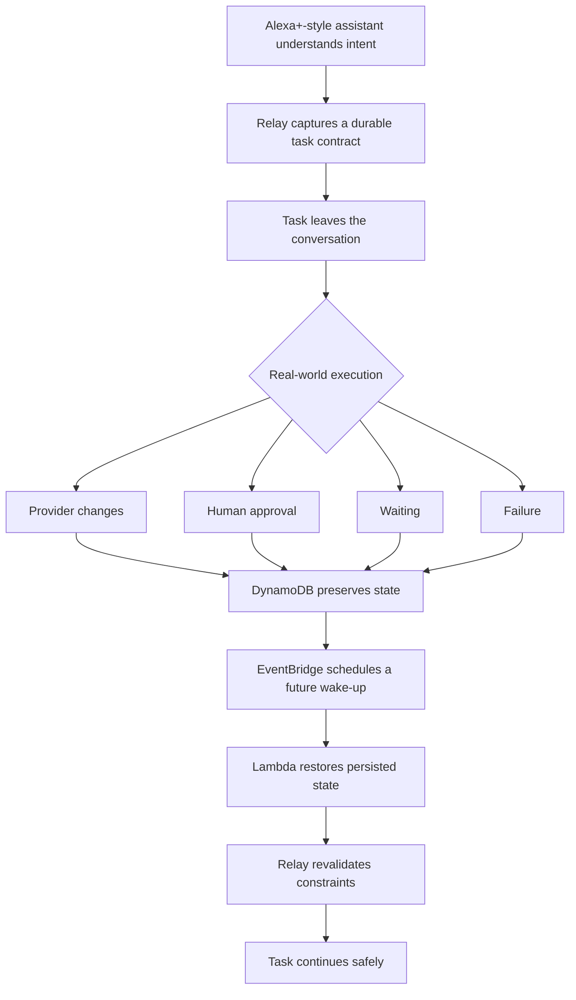
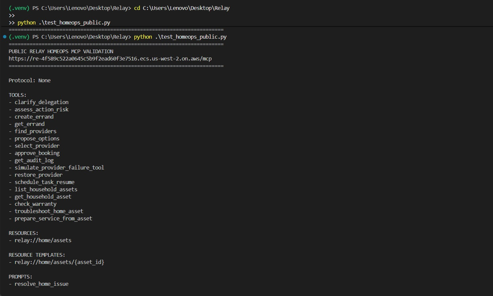
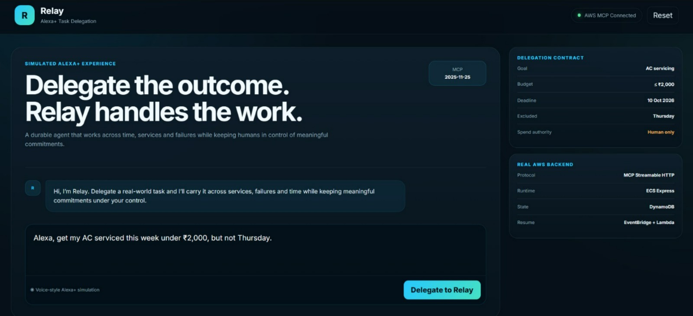
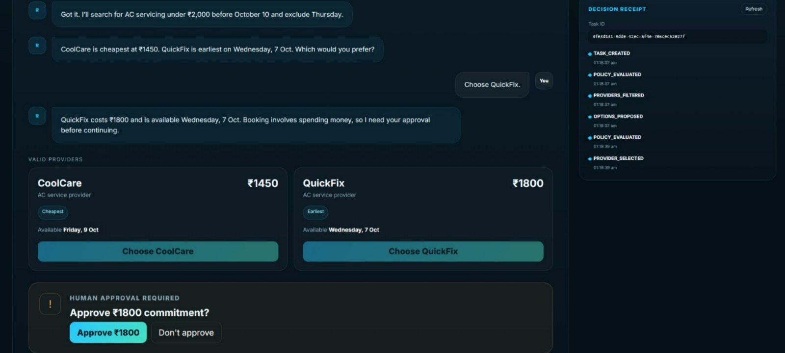
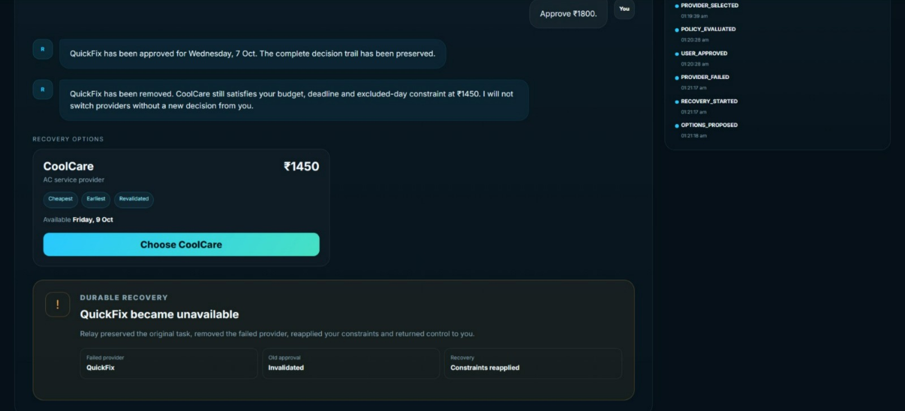
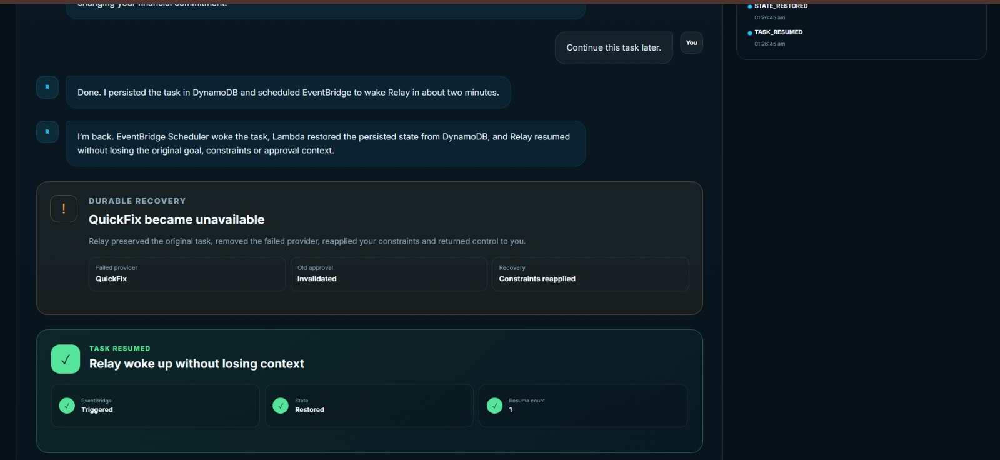
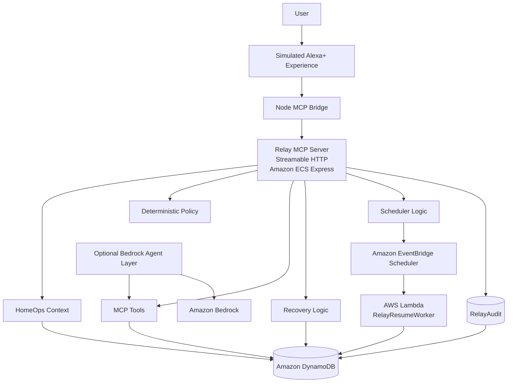
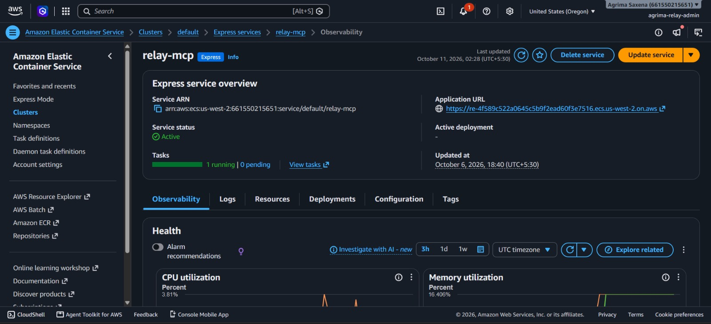
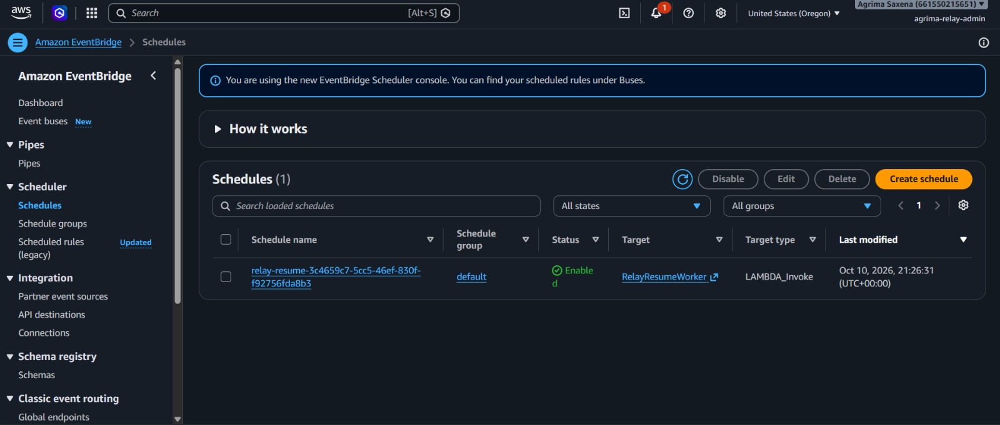
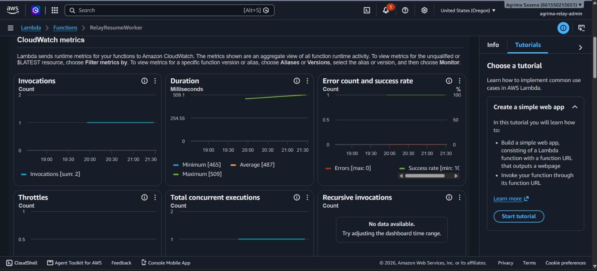

# 🔁 Relay

## The execution layer that helps Alexa+ tasks survive the real world.

> **Assistants are good at starting tasks. Relay is built for what happens next.**

****Relay preserves what the user meant across approvals, provider failures, waiting and future resume — without silently spending, weakening constraints or forgetting the original request.****

> ****Alexa+ understands what the user needs. Relay preserves what they meant and makes sure the task survives the real world.****

[](https://github.com/agcodes0315/Relaython)


**

<p align="center">
  <a href="https://github.com/agcodes0315/Relaython"></a>
  
  
  
  
</p>

<p align="center">
  <a href="https://www.linkedin.com/in/agrima-saxena-142960426/"></a>
  <a href="https://github.com/agcodes0315"></a>
  <a href="mailto:agrimalc@gmail.com"></a>
</p>

---

## 🎯 The Problem

AI assistants are good at understanding what a user wants.

The harder problem begins ****after the conversation****.

A real-world request may involve money, external providers, waiting, failures and decisions that happen minutes, hours or days later.

For example:

> ****"Alexa, get my AC serviced this week under ₹2,000, but not Thursday."****

Understanding that sentence is easy.

What happens when:

- the selected provider fails after approval?

- another provider costs more than the user's budget?

- the task has to wait until later?

- the application restarts?

- the original conversation is gone?

- the system needs to explain what changed and why?

****Relay is designed for that part of the problem.****

Most assistants are optimized for:

```text

ask → answer

```

Relay is designed for:

```text

understand

   ↓

persist intent

   ↓

act

   ↓

ask the human when required

   ↓

wait

   ↓

recover from failure

   ↓

resume later

   ↓

explain what happened

```

---

## ⚡ Problem → Task → Actions → Results

| | |
|---|---|
| **Problem** | Real-world agent tasks outlive the conversation: providers fail, approvals become stale, constraints can be lost, and work may need to resume later. |
| **Task** | Build a durable execution layer for Alexa+-style agents that preserves user intent and authority across failure, waiting and recovery. |
| **Actions** | Implemented a self-hosted MCP server with deterministic policy, context-bound approvals, constraint revalidation, DynamoDB persistence, EventBridge scheduling, Lambda resume and decision receipts. |
| **Results** | **17 tools · 2 resources · 1 prompt**, HomeOps **7/7**, preflight **6/6**, safety **6/6**, public recovery/resume validations passed, representative remote tool-call **p95 381.9 ms**, and **100/100** successful synthetic load requests. |

> **Outcome:** Relay preserves the original task contract, invalidates stale approval after execution context changes, recovers only within the user's constraints, and resumes persisted work later.

---

## 🧭 What Happens After the Conversation Ends?



**Relay is not an AC-service bot. HomeOps is the demonstration domain for a reusable durable-agent execution primitive.**

The same execution pattern can support travel disruption recovery, repair coordination, procurement, event vendors, recurring errands, appointment workflows, document follow-up, relocation and subscription management.

> The core idea is simple: **preserve intent, preserve authority, survive change, and resume safely.**

---

## 🧠 The Relay Contract

Relay turns conversational intent into a ****durable execution contract****.

```text

Goal

\+ Budget

\+ Deadline

\+ Excluded days

\+ Human authority

\+ Approval state

\+ Provider state

\+ Recovery state

\+ Resume state

```

That contract becomes the source of truth for the task.

The agent may adapt to changing circumstances, but it cannot silently rewrite what the user asked.

### Why this matters

A conversational agent may know what the user said **right now**. A real-world execution system must also remember:

- what may be changed,

- what must never be changed,

- what requires approval,

- whether an approval is still valid,

- what has already failed,

- what should happen after waiting,

- how to continue later.

Relay externalizes that state instead of relying only on conversational memory.

**---**

## 🏆 The Core Demonstration

This is the most important Relay story:

```text

User:

"Get my AC serviced this week

under ₹2,000,

but not Thursday."

        ↓

Relay stores the contract

        ↓

QuickFix — ₹1,800

        ↓

Human approval required

        ↓

User approves

        ↓

QuickFix becomes unavailable

        ↓

Old approval becomes invalid

        ↓

Relay reapplies the ORIGINAL contract

        ↓

PremiumAir ₹2,600 → rejected

Thursday options → rejected

Late options → rejected

        ↓

CoolCare ₹1,450 remains valid

        ↓

Fresh human approval required

        ↓

Task waits

        ↓

EventBridge wakes the task later

        ↓

Lambda restores persisted state

        ↓

TASK_RESUMED

        ↓

Decision Receipt explains everything

```

> ****Relay refuses to forget the user's rules when the world changes.****

That is the central design principle of the project.

**---**

## 🧩 Responsibility

Relay converts conversational intent into ****durable, policy-governed execution state****.

Its responsibilities are to:

- preserve user constraints outside conversational memory,

- expose actions through MCP,

- separate reversible from irreversible actions,

- require human approval before spend-related commitments,

- recover safely when providers fail,

- reapply the original contract during recovery,

- invalidate stale approvals when execution context changes,

- resume persisted work later,

- maintain an auditable decision trail,

- clearly distinguish real infrastructure from simulated hackathon integrations.

---

## ⚙️ Implementation

Relay is implemented as a self-hosted MCP backend using ****Streamable HTTP**** and MCP protocol ****2025-11-25****.

```text

understand

   ↓

clarify

   ↓

persist contract

   ↓

search / propose

   ↓

evaluate risk

   ↓

ask human when required

   ↓

recover if a provider fails

   ↓

schedule a future wake-up

   ↓

restore persisted state

   ↓

resume

   ↓

explain through an audit trail

```

The implementation combines:

- ****17 MCP tools****

- ****2 MCP resources****

- ****1 MCP prompt****

- deterministic safety and state validation

- DynamoDB task and audit state

- EventBridge Scheduler

- AWS Lambda resume worker

- public Amazon ECS Express deployment

- Amazon ECR container images

- optional Amazon Bedrock orchestration

- React + Node simulated Alexa+ experience

---

## 📈 Verified Results

| Result | Verified Outcome |
|---|---:|
| MCP tools | ****17**** |
| MCP resources | ****2**** |
| MCP prompts | ****1**** |
| MCP protocol | ****2025-11-25**** |
| HomeOps tests | ****7/7 passed**** |
| Preflight tests | ****6/6 passed**** |
| Safety tests | ****6/6 passed**** |
| Public failure-recovery test | ****Passed**** |
| Public durable-resume test | ****Passed**** |
| Representative remote tool-call p95 | ****381.9 ms**** |
| Synthetic concurrent-load test | ****100/100 successful requests**** |
| Synthetic concurrency | ****25 clients**** |
| Durable-state tables | ****2**** |
| Human approval before spend | ****Required**** |
| License | ****MIT**** |

> The concurrency test is a synthetic resilience test, not a claim of production-scale live-user traffic. Under that load, p95 latency increased to approximately ****2.69 seconds****.

---

# 🏠 Relay HomeOps

### Context-Aware Home Asset, Warranty and Service Orchestration

Relay HomeOps lets the workflow begin from the actual user problem:

```text

"Alexa, my AC isn't cooling properly."

        ↓

known household asset

        ↓

stored warranty context

        ↓

safe first-line troubleshooting

        ↓

service required?

        ↓

durable delegation contract

        ↓

provider search

        ↓

human approval

        ↓

failure recovery

        ↓

durable wait / resume

        ↓

decision receipt

```

### 🎥 Demo Coverage

The **HomeOps capabilities are implemented in the public MCP backend**. The simulated Alexa+ client focuses on the durable delegation lifecycle: contract creation, provider selection, approval, failure recovery, waiting, resume and audit.

For the hackathon demo, household assets, order history, warranty data, providers, pricing, availability, booking and payment are simulated. This was intentional: the implementation effort focused on the harder systems problem of preserving user intent, enforcing safety boundaries, recovering from failure and resuming durable work later.

The repository includes public backend validation for HomeOps asset lookup, warranty checking, conservative troubleshooting and service preparation.

### HomeOps Backend Proof

The current simulated Alexa+ frontend demonstrates the service-delegation, approval, recovery and resume flow.

HomeOps asset, warranty and troubleshooting capability is validated directly against the ****public MCP backend****.

<p align="center">

  

</p>

### Demo Asset

| Field | Value |
|---|---|
| Product | CoolBreeze Split AC |
| Model | CB-24X |
| Purchased | 2026-03-12 |
| Warranty expiry | 2027-03-12 |
| Retailer | Amazon |
| Location | Bedroom |

The household asset, order, warranty, provider, pricing and payment data shown in the demo are **simulated demo data**.

---

# 🖥️ Simulated Alexa+ Experience

The React frontend is a simulated Alexa+-style interface connected to the real Relay MCP backend.

It demonstrates:

- delegation,

- provider options,

- risk and approval state,

- failure recovery,

- durable wait,

- resume status,

- decision receipts.

The client surface is intentionally labeled **Simulated Alexa+ Experience**.

---

# 📝 Durable Delegation Contract

Relay persists the user's intent as a contract rather than relying only on conversational memory.

<p align="center">

  

</p>

Example contract:

| Constraint | Value |
|---|---|
| Goal | AC servicing |
| Maximum budget | ₹2,000 |
| Deadline | 10 Oct 2026 |
| Excluded day | Thursday |
| Spend authority | Human only |

Relay persists:

- goal

- budget

- deadline

- excluded weekdays

- selected provider

- approval state

- recovery state

- wait status

- resume count

- audit history

---

# 🛡️ Deterministic Safety Policy

Important constraints are enforced by Relay itself rather than delegated solely to a model.

| Check | Behavior |
|---|---|
| Budget | reject providers above the user's maximum |
| Deadline | reject providers that miss the deadline |
| Excluded weekdays | reject explicitly prohibited days |
| State transitions | prevent invalid workflow jumps |
| Provider validity | select only available providers |
| Spend | require explicit human approval |
| Recovery | reapply the original contract after failure |

Risk model:

```text

SEARCH        → LOW

PROPOSE       → LOW

SELECT        → MEDIUM / reversible

BOOK          → HIGH / approval required

unknown       → fail-safe / approval required

```

---

# 👤 Human Approval Gate

Relay separates recommendation from authorization.

<p align="center">

  

</p>

```text

Provider selected

      ↓

BOOK_PROVIDER evaluated

      ↓

REQUIRE_APPROVAL

      ↓

Human approves

      ↓

USER_APPROVED

```

Relay can search and recommend autonomously, but it cannot authorize spending on the user's behalf.

---

## 🔐 Context-Bound Approval

Approval in Relay belongs to a **specific execution context**.

If that context changes materially — for example, if the selected provider fails — the previous approval is invalidated.

```text

QuickFix ₹1,800 approved

        ↓

QuickFix fails

        ↓

execution context changed

        ↓

previous approval invalidated

        ↓

replacement option evaluated

        ↓

fresh approval required

```

Relay therefore does **not** treat consent as a reusable permission token.

Human approval remains tied to the action the user actually reviewed.

---

## ♻️ Constraint Revalidation

Recovery must never weaken the original task contract.

When a provider fails, Relay re-evaluates replacement options against the original:

- budget,

- deadline,

- excluded weekdays,

- provider availability,

- approval boundary.

Only compliant alternatives can move forward.

This behavior was strengthened after testing exposed a recovery case in which an invalid replacement could reappear. The bug was fixed and regression-tested.

---

# 🔁 Failure Recovery

The strongest part of the demo is what happens when the real world changes after approval.

<p align="center">

  

</p>

```text

QuickFix selected — ₹1,800

      ↓

human approval

      ↓

QuickFix becomes unavailable

      ↓

PROVIDER_FAILED

      ↓

old approval invalidated

      ↓

RECOVERY_STARTED

      ↓

original constraints reapplied

      ↓

invalid providers rejected

      ↓

CoolCare proposed — ₹1,450

      ↓

fresh human approval required

```

An earlier recovery defect allowed an option outside the original contract to reappear. The issue was reproduced, fixed and regression-tested.

See the [Hackathon Friction Log](./docs/friction-log.md).

---

# ⏰ Durable Wait and Resume

Relay does not depend on an open browser tab or an in-memory timer.

<p align="center">

  

</p>

The persisted workflow is:

```text

Task

  ↓

DynamoDB

  ↓

WAIT_SCHEDULED

  ↓

EventBridge Scheduler

  ↓

future trigger

  ↓

Lambda

  ↓

RESUME_TRIGGERED

  ↓

STATE_RESTORED

  ↓

TASK_RESUMED

```

Public validation confirmed:

```text

WAIT_SCHEDULED   ✓

RESUME_TRIGGERED ✓

STATE_RESTORED   ✓

TASK_RESUMED     ✓

Resume count: 1

```

---

# 🧾 Decision Receipt

Every important execution transition produces an auditable event.

The receipt lets a user or developer answer:

- What did Relay understand?

- Which constraints were enforced?

- Why was an option rejected?

- Who approved spending?

- What failed?

- Why did Relay choose a replacement?

- When was the task resumed?

- What state was restored?

Representative audit events:

| Event | Meaning |
|---|---|
| `TASK_CREATED` | delegation stored |
| `POLICY_EVALUATED` | deterministic policy checked |
| `PROVIDERS_FILTERED` | invalid providers removed |
| `OPTIONS_PROPOSED` | valid choices returned |
| `PROVIDER_SELECTED` | provider selected |
| `USER_APPROVED` | human approval recorded |
| `PROVIDER_FAILED` | provider failed |
| `RECOVERY_STARTED` | recovery began |
| `WAIT_SCHEDULED` | future resume scheduled |
| `RESUME_TRIGGERED` | Lambda wake-up |
| `STATE_RESTORED` | persisted task reloaded |
| `TASK_RESUMED` | task continued |

The goal is to make agent behavior inspectable rather than opaque.

---

# 🏗️ Architecture



### Durable Resume Path

```text

Relay task

   ↓

DynamoDB

   ↓

WAIT_SCHEDULED

   ↓

EventBridge Scheduler

   ↓

Lambda

   ↓

RESUME_TRIGGERED

   ↓

STATE_RESTORED

   ↓

TASK_RESUMED

```

### Responsibility Boundary

```text

Alexa+-style client

        ↓

conversation / intent

        ↓

Relay

        ↓

durable external task state

constraints

risk policy

approval state

recovery state

resume state

audit history

```

Relay does **not** claim to replace Alexa+ conversational continuity. It focuses on durable execution outside the conversation.

---

# 🔌 MCP Surface

## 17 Tools

| Tool | Responsibility |
|---|---|
| `clarify_delegation` | detect missing constraints |
| `assess_action_risk` | classify risk and approval requirements |
| `create_errand` | create a durable task contract |
| `get_errand` | load persisted task state |
| `find_providers` | filter providers against constraints |
| `propose_options` | present valid provider options |
| `select_provider` | select a reversible option |
| `approve_booking` | record explicit human approval |
| `get_audit_log` | retrieve the decision receipt |
| `simulate_provider_failure_tool` | simulate provider cancellation |
| `restore_provider` | restore provider state after testing |
| `schedule_task_resume` | schedule a future wake-up |
| `list_household_assets` | list demo HomeOps assets |
| `get_household_asset` | retrieve one asset |
| `check_warranty` | evaluate stored warranty state |
| `troubleshoot_home_asset` | return conservative troubleshooting |
| `prepare_service_from_asset` | convert asset context into a Relay service contract |

## 2 Resources

```text

relay://home/assets

relay://home/assets/{asset_id}

```

## 1 Prompt

```text

resolve_home_issue

```

---

# ⚡ Performance Validation

### Representative Remote MCP Calls

50 measured runs after warm-up:

| Operation | Median | p95 |
|---|---:|---:|
| `/health` | 269.1 ms | 362.7 ms |
| `tools/list` | 271.5 ms | 358.7 ms |
| `assess_action_risk` | 272.8 ms | 352.0 ms |
| `get_errand` | 275.8 ms | **381.9 ms** |

### Synthetic Concurrent Load

```text

Concurrency: 25

Requests:    100

Successful:  100/100

Throughput:  ~10.08 successful requests/sec

Median:      ~2313.5 ms

p95:         ~2693.8 ms

```

This is a resilience test, not a claim of production-scale live-user performance.

---

# ☁️ AWS Builder Integration

Relay's AWS story is not a single model call. The durable execution lifecycle crosses multiple AWS services.

| AWS Service | Use |
|---|---|
| Amazon ECS Express | hosts the public MCP server |
| Amazon ECR | stores container images |
| Amazon DynamoDB | stores task and audit state |
| Amazon EventBridge Scheduler | schedules durable future wake-ups |
| AWS Lambda | restores and resumes tasks |
| Amazon Bedrock | optional model orchestration |
| AWS IAM | execution, task and scheduler permissions |

Critical continuation path:

```text

MCP Server

   ↓

DynamoDB

   ↓

EventBridge Scheduler

   ↓

Lambda

   ↓

DynamoDB

   ↓

resumed task

```

This is the AWS path that allows Relay to continue even after the original request/interaction is over.

### 📸 AWS Deployment Evidence

| Evidence | Proof |
|---|---|
| Amazon ECS Express | public `relay-mcp` service active and running |
| Amazon ECR | deployed `homeops-v2` container image |
| Amazon DynamoDB | `RelayTasks` durable contracts and `RelayAudit` decision events |
| Amazon EventBridge Scheduler | live `relay-resume-*` future wake-up |
| AWS Lambda | `RelayResumeWorker` restores/resumes persisted tasks |
| CloudWatch/Lambda metrics | successful invocations with zero errors in captured run |
| Amazon Bedrock | optional `openai.gpt-oss-20b` model configuration/catalog evidence |

<p align="center">
  
</p>

<p align="center"><em>Real AWS deployment: Relay's public MCP server running on Amazon ECS Express.</em></p>

<p align="center">
  
</p>

<p align="center"><em>Real durable continuation: EventBridge Scheduler targets RelayResumeWorker for a future wake-up.</em></p>

<p align="center">
  
</p>

<p align="center"><em>Real resume execution: RelayResumeWorker invocation evidence from AWS Lambda.</em></p>

> Additional AWS screenshots are kept under `docs/images/aws/`.


---

# 🌐 Public MCP Endpoint

### MCP

```text

https://re-4f589c522a0645c5b9f2ead60f3e7516.ecs.us-west-2.on.aws/mcp

```

### Health

```text

https://re-4f589c522a0645c5b9f2ead60f3e7516.ecs.us-west-2.on.aws/health

```

Protocol:

```text

2025-11-25

```

---

# 🤖 Optional Amazon Bedrock Agent Layer

Relay includes a separate optional model-orchestration layer using Amazon Bedrock.

Default model configuration:

```text

openai.gpt-oss-20b

```

The polished UI calls Relay MCP tools directly.

Deterministic safety, provider filtering, approval boundaries, recovery and task state do **not** depend on the model.

This separation is intentional: generative reasoning can help orchestration, while policy-critical decisions remain deterministic and inspectable.

---

# 🧪 Testing

### Unit tests (offline)

Run from the repository root. `pytest.ini` makes the default command run only the offline unit tests in `tests/unit/`:

```bash
python -m pytest
```

To run an individual unit test module:

```bash
python -m pytest tests/unit/test_homeops.py -v
python -m pytest tests/unit/test_improvement_guards.py -v
python -m pytest tests/unit/test_preflight.py -v
python -m pytest tests/unit/test_relay_safety.py -v
```

Validated:

```text

HomeOps:   7/7 passed

Preflight: 6/6 passed

Safety:    6/6 passed

```

### Integration (needs AWS credentials)

Run from the repository root:

```bash
python -m tests.integration.test_dynamodb
python -m tests.integration.test_recovery
python -m tests.integration.test_scheduler
```

### Public AWS

```powershell

python tests/e2e/test_mcp_http.py

python tests/e2e/test_homeops_public.py

python tests/e2e/test_recovery_public.py

python tests/e2e/test_resume_public.py

```

Validated:

```text

Public HomeOps MCP validation: passed

Public failure recovery:       passed

Public durable resume:         passed

```

---

# 🌍 One Demo Domain, General Execution Primitive

HomeOps is Relay's demonstration domain.

The underlying execution model is reusable anywhere a task must survive changing external conditions.

Potential applications include:

- travel disruption recovery,

- household maintenance,

- procurement,

- appointment coordination,

- event vendors,

- relocation,

- recurring errands,

- subscription changes,

- document follow-ups,

- multi-step purchasing workflows.

The common problem is the same:

> **preserve intent, preserve authority, survive change, and resume safely.**

Relay is therefore **not an AC-service bot**. HomeOps is the proof domain for a reusable durable-agent execution primitive.

---

# 💡 Why Relay Is More Than a Basic MCP Wrapper

Relay is not simply an API placed behind MCP.

It adds execution semantics around the tools:

- durable contracts,

- deterministic policy,

- risk classification,

- human approval,

- approval invalidation,

- failure recovery,

- constraint revalidation,

- scheduled waiting,

- persistent state restoration,

- decision receipts.

The value comes from how those components work together across time and failure.

---

# 🎯 Judging Alignment

### Technical Implementation

Relay demonstrates a working self-hosted MCP server, public AWS deployment, persistent state, event-driven resumption, deterministic safety controls, automated tests and remote validation.

### Design

The system separates:

- conversation from execution state,

- model reasoning from hard policy,

- reversible actions from irreversible commitments,

- old consent from changed execution context.

### Potential Impact

The same durable execution pattern can extend beyond HomeOps into commerce, travel, events, procurement, relocation and other long-running agentic workflows.

### Quality of the Idea

Relay focuses on a problem that becomes more important as assistants become more agentic:

> **What happens after the assistant understands the request?**

Its answer is durable execution with explicit user authority.

---

# 🧭 Amazon Leadership Principles Reflected in the Engineering

Relay is not an Amazon product and this section does not imply Amazon endorsement. It explains how the engineering decisions reflect similar problem-solving behaviors.

| Leadership Principle | How Relay Reflects It |
|---|---|
| **Customer Obsession** | user constraints, safety boundaries and approval authority remain the source of truth |
| **Ownership** | the workflow owns recovery, resume and audit instead of handing failure back to the user |
| **Invent and Simplify** | durable execution is reduced to an explicit task contract and MCP surface |
| **Are Right, A Lot** | deterministic policy and tests verify assumptions instead of trusting model output blindly |
| **Learn and Be Curious** | the project explores MCP Resources, Prompts, Streamable HTTP, ECS Express, EventBridge, Lambda and Bedrock |
| **Hire and Develop the Best** | documentation, tests and reusable patterns are designed to help future contributors build on the work |
| **Insist on the Highest Standards** | recovery bugs were reproduced and fixed, safety rules regression-tested, and limitations documented |
| **Think Big** | Relay is designed as a reusable durable-execution pattern rather than only an AC-service demo |
| **Bias for Action** | reversible actions proceed quickly while irreversible spending pauses for approval |
| **Frugality** | focused managed AWS services and simulated integrations were used where production APIs were unavailable |
| **Earn Trust** | Relay records decision receipts and clearly discloses simulated integrations |
| **Dive Deep** | debugging covered policy, Docker images, ECS revisions, IAM, MCP transport, DynamoDB and EventBridge/Lambda |
| **Have Backbone; Disagree and Commit** | model autonomy is intentionally constrained where deterministic policy or human approval is safer |
| **Deliver Results** | the system is publicly deployed, tested, benchmarked and versioned |
| **Strive to be Earth's Best Employer** | the human-in-the-loop design keeps people informed and in control of meaningful commitments |
| **Success and Scale Bring Broad Responsibility** | authentication, privacy, provider verification, abuse controls and payment safety are explicitly documented as production requirements |

---

# ✅ Real vs Simulated

| Simulated for the Hackathon | Real Implementation |
|---|---|
| Alexa+ client surface | MCP Streamable HTTP backend |
| household order records | public AWS-hosted MCP endpoint |
| manufacturer warranty feed | DynamoDB persistence |
| service providers | deterministic policy |
| provider prices / availability | approval boundary |
| actual booking | failure recovery |
| payment / Amazon Wallet | EventBridge scheduled resume |
| provider transaction APIs | Lambda task restoration |
| | audit trail |

---

# 🔐 Security and Production Boundaries

Current controls:

- Host and Origin validation

- deterministic constraint validation

- state-transition validation

- human approval before spend

- provider revalidation after failure

- safe troubleshooting escalation

- audit history

Production hardening still required:

- production authentication

- per-user authorization

- per-task authorization

- secret management

- provider identity verification

- rate limiting

- payment security

- idempotent transactions

- monitoring and abuse controls

- privacy and retention controls

See [Production Authentication Architecture](./docs/production-auth-architecture.md).

---

## 🧩 Known Hackathon Boundaries

Relay deliberately prioritizes durable execution over breadth of external integrations.

- The polished frontend demonstrates the delegation lifecycle; the full HomeOps asset/warranty flow is validated through the public MCP backend.
- External providers, prices, availability, booking and payment are simulated.
- Production OAuth/account linking and per-user authorization are not implemented; the repository documents the production authentication architecture separately.
- The synthetic load test demonstrates resilience under controlled concurrency, not production-scale live traffic.

These are explicit scope boundaries rather than hidden claims.

---

# ⚠️ Current Scope

Relay does **not** claim:

- production Alexa+ integration

- live Amazon customer order access

- live manufacturer warranty APIs

- real technician booking

- real payment execution

- production authentication

- production provider verification

- production-scale live-user traffic

These boundaries are documented intentionally.

---

# 🛠️ Feature Requests

These requests come directly from the implementation experience while building Relay.

### 1. MCP Inspector support for end-to-end Streamable HTTP workflows
**Priority:** Important

A workflow-oriented inspector that can preserve task context across multiple MCP tool calls would make durable-agent debugging significantly easier.

### 2. First-class durable workflow primitives for MCP
**Priority:** Nice-to-have

Standard patterns for wait, resume, approval invalidation and state restoration would reduce custom infrastructure for long-running MCP agents.

### 3. Easier Alexa+ local simulation for self-hosted MCP servers
**Priority:** Important

A locally available Alexa+-style testing harness would let developers validate conversational and visual integration before gated production access.

### 4. AWS reference architecture for durable MCP agents
**Priority:** Nice-to-have

A documented ECS + DynamoDB + EventBridge Scheduler + Lambda pattern would shorten onboarding for developers building long-running MCP workflows.

---


# 🌱 What's Next

| Expansion | Example |
|---|---|
| Relay Commerce | contextual procurement and cart optimization |
| Relay Events | multi-vendor event coordination |
| Relay Move | relocation orchestration |
| Relay Kitchen | pantry and grocery workflows |
| Relay Travel | long-running trip coordination |
| Relay Asset Vault | real warranty and receipt integrations |
| DurableMCP | reusable open-source durable MCP starter |

The hackathon flagship remains **HomeOps**.

---

# 🗣️ Judge Pitch

### 10-second version

> **Relay is the execution layer for Alexa+-style agents. It turns a user's request into a durable contract that survives provider failures, human approvals, waiting and future resume without forgetting or weakening what the user originally asked.**

### 20-second version

> **Most assistants are good at understanding a request, but real tasks continue after the conversation ends. Relay externalizes the user's intent into durable state. If a provider fails after approval, Relay invalidates the old approval, reapplies the original constraints, finds a compliant alternative, asks again when required, and can resume later through EventBridge and Lambda.**

---

# 📁 Repository Structure

```text
Relay/
│
├── server.py                 # MCP server entry point (Dockerfile copies it, so it stays at the root)
├── relay/                    # core package: policy, store, recovery, scheduler, tools, HomeOps
├── relay-ui/                 # simulated Alexa+ web UI and bridge
├── lambda/
│   └── resume_worker/
│       └── handler.py        # durable-resume Lambda
├── infra/
│   ├── iam/                  # IAM trust and policy documents
│   └── legacy-apprunner/     # earlier App Runner configs, kept for reference
├── scripts/
│   ├── benchmarks/           # latency and load tests
│   ├── bedrock/              # Bedrock connectivity checks
│   └── run_agent.py          # optional Bedrock agent layer
├── tests/
│   ├── unit/                 # offline tests
│   ├── integration/          # need AWS credentials
│   └── e2e/                  # call the deployed endpoint
├── docs/                     # product feedback, friction log, feature requests, auth architecture
├── Dockerfile
├── requirements.txt          # local development
├── requirements-docker.txt   # runtime dependencies used by the Docker image
├── pytest.ini
├── .env.example
├── LICENSE
└── README.md
```

---

# ⚙️ Running Locally

### Backend

```powershell

python -m venv .venv

Set-ExecutionPolicy `

  -Scope Process `

  -ExecutionPolicy RemoteSigned

.\.venv\Scripts\Activate.ps1

python -m pip install -r requirements.txt

python .\server.py

```

Local endpoints:

```text

http://localhost:8000/health

http://localhost:8000/mcp

```

### macOS / Linux

```bash
python3 -m venv .venv
source .venv/bin/activate
python -m pip install -r requirements.txt
python server.py
```

### Configuration

Settings are read from environment variables, and every one has a default for local runs.
See [`.env.example`](./.env.example) for the full list. The code does not load `.env` files by itself, so export the values:

```bash
cp .env.example .env
set -a; source .env; set +a
```

- `/health` works without AWS. The task tools need AWS credentials and the `RelayTasks` and `RelayAudit` DynamoDB tables.
- On a deployed host, set `RELAY_PUBLIC_HOST` to the public hostname (comma-separated for several). Requests to hosts that are not listed are rejected by the server's DNS-rebinding protection.
- The optional Bedrock agent layer needs `OPENAI_API_KEY` and is started with `python -m scripts.run_agent`.


### Frontend bridge — WSL / Ubuntu

```bash

cd ~/relay-ui

sudo fuser -k 8787/tcp 2>/dev/null || true

nohup node server/bridge.mjs > bridge.log 2>&1 &

curl http://localhost:8787/api/health

```

### Frontend

```bash

cd ~/relay-ui

npm run dev -- --host 0.0.0.0

```

---

## 🧪 Engineering Friction Log

Relay includes a real development friction log covering recovery-policy defects, stale container deployment, MCP SDK field mismatches, EventBridge/Lambda/IAM setup, AWS authentication friction and Windows/WSL environment issues.

Each entry records:

`Task attempted → Steps taken → Expected result → Actual result → Severity → Workaround → Actionable suggestion`

See [`docs/friction-log.md`](./docs/friction-log.md).

---

# 📚 Documentation

| Resource | Link |
|---|---|
| Product Feedback | [`docs/product-feedback.md`](./docs/product-feedback.md) |
| Hackathon Friction Log | [`docs/friction-log.md`](./docs/friction-log.md) |
| Production Authentication Architecture | [`docs/production-auth-architecture.md`](./docs/production-auth-architecture.md) |
| HomeOps Tests | [`tests/unit/test_homeops.py`](./tests/unit/test_homeops.py) |
| HomeOps Public Test | [`tests/e2e/test_homeops_public.py`](./tests/e2e/test_homeops_public.py) |
| Safety Tests | [`tests/unit/test_relay_safety.py`](./tests/unit/test_relay_safety.py) |
| Failure Recovery Test | [`tests/e2e/test_recovery_public.py`](./tests/e2e/test_recovery_public.py) |
| Durable Resume Test | [`tests/e2e/test_resume_public.py`](./tests/e2e/test_resume_public.py) |
| Latency Benchmark | [`scripts/benchmarks/benchmark_mcp_latency_v2.py`](./scripts/benchmarks/benchmark_mcp_latency_v2.py) |
| Load Test | [`scripts/benchmarks/load_test_mcp.py`](./scripts/benchmarks/load_test_mcp.py) |
| MIT License | [`LICENSE`](./LICENSE) |
| Repository | [Relaython](https://github.com/agcodes0315/Relaython) |

---

# 🏆 What Relay Demonstrates

Relay brings together:

- MCP tool design

- MCP Resources and Prompts

- Streamable HTTP

- durable task execution

- durable task contracts

- context-bound approvals

- deterministic safety

- state-machine validation

- human-in-the-loop approval

- constraint revalidation

- failure recovery

- scheduled continuation

- persistent cloud state

- event-driven AWS infrastructure

- decision receipts

- benchmarking

- public end-to-end validation

- explicit real-vs-simulated boundaries

> **A useful real-world agent should not merely know what the user asked. It should preserve the contract, respect the boundaries, survive failure and continue safely when the world changes.**

---

# 👩‍💻 Author

### Agrima Saxena

**Software Engineering · Applied AI · Agentic Systems**

<p>
  <a href="https://www.linkedin.com/in/agrima-saxena-142960426/"></a>
  <a href="https://github.com/agcodes0315"></a>
  <a href="mailto:agrimalc@gmail.com"></a>
</p>

---

# 📄 License

Relay is released under the [MIT License](./LICENSE).
