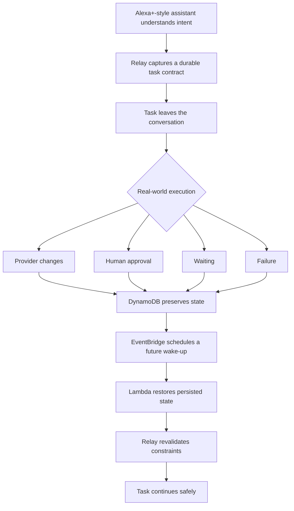

# 🔁 Relay

## The execution layer that helps Alexa+ tasks survive the real world.

> **Assistants are good at starting tasks. Relay is built for what happens next.**

****Relay preserves what the user meant across approvals, provider failures, waiting and future resume without silently spending, weakening constraints or forgetting the original request.****

> ****Alexa+ understands what the user needs. Relay preserves what they meant and makes sure the task survives the real world.****

<p align="center">
  <a href="https://github.com/agcodes0315/Relaython"></a>
  
  
  
  
</p>

---

## 🎯 The Problem

AI assistants are good at understanding what a user wants.

The harder problem begins ****after the conversation****.

A real-world request may involve money, external providers, waiting, failures and decisions that happen minutes, hours or days later.

For example:

> ****"Alexa, get my AC serviced this week under ₹2,000, but not Thursday."****

Understanding that sentence is easy.

What happens when:

- the selected provider fails after approval?
- another provider costs more than the user's budget?
- the task has to wait until later?
- the application restarts?
- the original conversation is gone?
- the system needs to explain what changed and why?

****Relay is designed for that part of the problem.****

Most assistants are optimized for:

```text
ask → answer
```

Relay is designed for:

```text
understand
  ↓
persist intent
  ↓
act
  ↓
ask the human when required
  ↓
wait
  ↓
recover from failure
  ↓
resume later
  ↓
explain what happened
```

---

## ⚡ Problem → Task → Actions → Results

| | |
|---|---|
| **Problem** | Real-world agent tasks outlive the conversation: providers fail, approvals become stale, constraints can be lost, and work may need to resume later. |
| **Task** | Build a durable execution layer for Alexa+-style agents that preserves user intent and authority across failure, waiting and recovery. |
| **Actions** | Implemented a self-hosted MCP server with deterministic policy, context-bound approvals, constraint revalidation, DynamoDB persistence, EventBridge scheduling, Lambda resume and decision receipts, plus **Relay Shield**, a family scam-protection workflow built on the same durable execution layer. |
| **Results** | **26 tools · 3 resources · 2 prompts**, **420 offline unit tests**, HomeOps **7/7**, preflight **6/6**, safety **6/6**, public recovery/resume validations passed, representative remote tool-call **p95 381.9 ms**, and **100/100** successful synthetic load requests. |

> **Outcome:** Relay preserves the original task contract, invalidates stale approval after execution context changes, recovers only within the user's constraints, and resumes persisted work later.

---

## 🧭 What Happens After the Conversation Ends?



**Relay is not an AC-service bot. HomeOps is the demonstration domain for a reusable durable-agent execution primitive.**

The same execution pattern can support travel disruption recovery, repair coordination, procurement, event vendors, recurring errands, appointment workflows, document follow-up, relocation and subscription management.

> The core idea is simple: **preserve intent, preserve authority, survive change, and resume safely.**

---

## 🧠 The Relay Contract

Relay turns conversational intent into a ****durable execution contract****.

```text
Goal
+ Budget
+ Deadline
+ Excluded days
+ Human authority
+ Approval state
+ Provider state
+ Recovery state
+ Resume state
```

That contract becomes the source of truth for the task.

The agent may adapt to changing circumstances, but it cannot silently rewrite what the user asked.

### Why this matters

A conversational agent may know what the user said **right now**. A real-world execution system must also remember:

- what may be changed,
- what must never be changed,
- what requires approval,
- whether an approval is still valid,
- what has already failed,
- what should happen after waiting,
- how to continue later.

Relay externalizes that state instead of relying only on conversational memory.

**---**

## 🏆 The Core Demonstration

This is the most important Relay story:

```text
User:
"Get my AC serviced this week
under ₹2,000,
but not Thursday."
  ↓
Relay stores the contract
  ↓
QuickFix ₹1,800
  ↓
Human approval required
  ↓
User approves
  ↓
QuickFix becomes unavailable
  ↓
Old approval becomes invalid
  ↓
Relay reapplies the ORIGINAL contract
  ↓
PremiumAir ₹2,600 → rejected
Thursday options → rejected
Late options → rejected
  ↓
CoolCare ₹1,450 remains valid
  ↓
Fresh human approval required
  ↓
Task waits
  ↓
EventBridge wakes the task later
  ↓
Lambda restores persisted state
  ↓
TASK_RESUMED
  ↓
Decision Receipt explains everything
```

> ****Relay refuses to forget the user's rules when the world changes.****

That is the central design principle of the project.

**---**

## 🧩 Responsibility

Relay converts conversational intent into ****durable, policy-governed execution state****.

Its responsibilities are to:

- preserve user constraints outside conversational memory,
- expose actions through MCP,
- separate reversible from irreversible actions,
- require human approval before spend-related commitments,
- recover safely when providers fail,
- reapply the original contract during recovery,
- invalidate stale approvals when execution context changes,
- resume persisted work later,
- maintain an auditable decision trail,
- clearly distinguish real infrastructure from simulated hackathon integrations.

---

## ⚙️ Implementation

Relay is implemented as a self-hosted MCP backend using ****Streamable HTTP**** and MCP protocol ****2025-11-25****.

```text
understand
  ↓
clarify
  ↓
persist contract
  ↓
search / propose
  ↓
evaluate risk
  ↓
ask human when required
  ↓
recover if a provider fails
  ↓
schedule a future wake-up
  ↓
restore persisted state
  ↓
resume
  ↓
explain through an audit trail
```

The implementation combines:

- ****26 MCP tools**** (17 Relay core + 9 Relay Shield)
- ****3 MCP resources****
- ****2 MCP prompts****
- deterministic safety and state validation
- Relay Shield: scam scoring, payment holds, one-time family approval codes and escalation timers
- DynamoDB task and audit state
- EventBridge Scheduler
- AWS Lambda resume worker
- public Amazon ECS Express deployment
- Amazon ECR container images
- optional Amazon Bedrock orchestration
- React + Node simulated Alexa+ experience

---

## 📈 Verified Results

| Result | Verified Outcome |
|---|---:|
| MCP tools | ****26**** (17 core + 9 Relay Shield) |
| MCP resources | ****3**** |
| MCP prompts | ****2**** |
| MCP protocol | ****2025-11-25**** |
| Offline unit tests (`python -m pytest`) | ****420 passed**** |
| HomeOps tests | ****7/7 passed**** |
| Preflight tests | ****6/6 passed**** |
| Safety tests | ****6/6 passed**** |
| Public failure-recovery test | ****Passed**** |
| Public durable-resume test | ****Passed**** |
| Representative remote tool-call p95 | ****381.9 ms**** |
| Synthetic concurrent-load test | ****100/100 successful requests**** |
| Synthetic concurrency | ****25 clients**** |
| Durable-state tables | ****2**** |
| Human approval before spend | ****Required**** |
| License | ****MIT**** |

> The concurrency test is a synthetic resilience test, not a claim of production-scale live-user traffic. Under that load, p95 latency increased to approximately ****2.69 seconds****. Latency and load figures were measured on the original 17-tool deployment, before Relay Shield was added, and have not been repeated for the Shield path.

---

# 🏠 Relay HomeOps

### Context-Aware Home Asset, Warranty and Service Orchestration

Relay HomeOps lets the workflow begin from the actual user problem:

```text
"Alexa, my AC isn't cooling properly."
  ↓
known household asset
  ↓
stored warranty context
  ↓
safe first-line troubleshooting
  ↓
service required?
  ↓
durable delegation contract
  ↓
provider search
  ↓
human approval
  ↓
failure recovery
  ↓
durable wait / resume
  ↓
decision receipt
```

### 🎥 Demo Coverage

The **HomeOps capabilities are implemented in the public MCP backend**. The simulated Alexa+ client focuses on the durable delegation lifecycle: contract creation, provider selection, approval, failure recovery, waiting, resume and audit.

For the hackathon demo, household assets, order history, warranty data, providers, pricing, availability, booking and payment are simulated. This was intentional: the implementation effort focused on the harder systems problem of preserving user intent, enforcing safety boundaries, recovering from failure and resuming durable work later.

The repository includes public backend validation for HomeOps asset lookup, warranty checking, conservative troubleshooting and service preparation.

### HomeOps Backend Proof

The current simulated Alexa+ frontend demonstrates the service-delegation, approval, recovery and resume flow.

HomeOps asset, warranty and troubleshooting capability is validated directly against the ****public MCP backend****.

<p align="center">
  
</p>

### Demo Asset

| Field | Value |
|---|---|
| Product | CoolBreeze Split AC |
| Model | CB-24X |
| Purchased | 2026-03-12 |
| Warranty expiry | 2027-03-12 |
| Retailer | Amazon |
| Location | Bedroom |

The household asset, order, warranty, provider, pricing and payment data shown in the demo are **simulated demo data**.

---

# 🖥️ Simulated Alexa+ Experience

The React frontend is a simulated Alexa+-style interface connected to the real Relay MCP backend.

It demonstrates:

- delegation,
- provider options,
- risk and approval state,
- failure recovery,
- durable wait,
- resume status,
- decision receipts.

The client surface is intentionally labeled **Simulated Alexa+ Experience**.

---

# 📝 Durable Delegation Contract

Relay persists the user's intent as a contract rather than relying only on conversational memory.

<p align="center">
  
</p>

Example contract:

| Constraint | Value |
|---|---|
| Goal | AC servicing |
| Maximum budget | ₹2,000 |
| Deadline | 10 Oct 2026 |
| Excluded day | Thursday |
| Spend authority | Human only |

Relay persists:

- goal
- budget
- deadline
- excluded weekdays
- selected provider
- approval state
- recovery state
- wait status
- resume count
- audit history

---

# 🛡️ Deterministic Safety Policy

Important constraints are enforced by Relay itself rather than delegated solely to a model.

| Check | Behavior |
|---|---|
| Budget | reject providers above the user's maximum |
| Deadline | reject providers that miss the deadline |
| Excluded weekdays | reject explicitly prohibited days |
| State transitions | prevent invalid workflow jumps |
| Provider validity | select only available providers |
| Spend | require explicit human approval |
| Recovery | reapply the original contract after failure |

## Team

Built by **Agrima Saxena** and **Ayush Verma** for the Amazon Developer Hackathon 2026.

| | Contribution |
|---|---|
| **Agrima Saxena** | Original Relay: durable errand contract, deterministic policy, context-bound approvals, failure recovery, durable resume, HomeOps, AWS deployment. Co-built Relay Shield. |
| **Ayush Verma** | Relay Shield: scoring and classifier, payment policy, case state machine, family approval codes, timers and Lambda branch, Shield UI, tests and documentation. Co-built Relay Shield with Agrima. |

<p>
  <a href="https://www.linkedin.com/in/agrima-saxena-142960426/"></a>
  <a href="https://github.com/agcodes0315"></a>
  <a href="https://github.com/Ayush-23479"></a>
</p>

---

# 👤 Human Approval Gate

Relay separates recommendation from authorization.

<p align="center">
  
</p>

```text
{