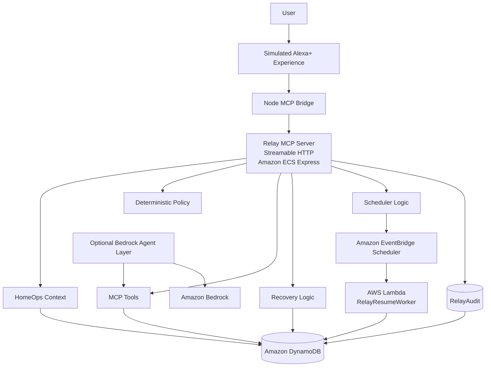

# 🔁 Relay

### Durable Alexa+-Style Task Execution Across Time, Failures, Human Decisions and AWS

**Relay is a durable task-execution system for Alexa+-style experiences. It turns conversational intent into persistent, policy-governed work that can survive provider failure, wait safely, resume later, and require human approval before irreversible actions.**

[](https://github.com/agcodes0315/Relaython)
[](https://github.com/agcodes0315/Relaython/releases/tag/v1.0.0)


> **Alexa+ understands what the user needs. Relay preserves what they meant and makes sure the task survives the real world.**

---

## 🎯 Problem

Most assistants are excellent at:

```text
ask → answer
```

Real-world delegation is harder.

A task can span external services, money, waiting, failures, constraints, and later decisions. If the selected provider disappears, the assistant should not forget the budget. If spending is involved, it should not silently authorize a transaction. If the task needs to continue later, it should not depend on an in-memory timer or an open browser tab.

Example:

```text
"Alexa, get my AC serviced this week under ₹2,000, but not Thursday."
```

The difficult part is not parsing the sentence. The difficult part is preserving the user's contract until the work is safely completed.

Relay addresses that execution gap.

---

## 🧩 Task / Responsibility

Relay's responsibility is to convert conversational intent into **durable external task state** and carry that state safely across time and failure.

The system must:

- preserve user constraints outside conversational memory
- expose actions through MCP
- distinguish reversible actions from irreversible ones
- require human approval before spend-related commitment
- recover safely if an external provider fails
- reapply the original contract during recovery
- schedule a future wake-up using cloud infrastructure
- restore persisted state when the task resumes
- leave a decision receipt showing what happened and why
- clearly separate real infrastructure from simulated hackathon integrations

---

## ⚙️ Action Taken

Relay was implemented as a self-hosted MCP backend using **Streamable HTTP** and MCP protocol **2025-11-25**.

```text
understand
   ↓
clarify missing constraints
   ↓
persist delegation contract
   ↓
search / propose
   ↓
evaluate risk
   ↓
ask human if required
   ↓
recover if the provider fails
   ↓
schedule a future wake-up
   ↓
restore persisted state
   ↓
resume
   ↓
explain through the audit trail
```

The implementation combines:

- **17 MCP tools**
- **2 MCP resources**
- **1 MCP prompt**
- deterministic policy and state validation
- DynamoDB task and audit state
- EventBridge Scheduler
- Lambda resume worker
- public Amazon ECS Express deployment
- Amazon ECR container images
- optional Amazon Bedrock orchestration
- React + Node simulated Alexa+ experience

---

## 📈 Results

| Result | Verified Outcome |
|---|---:|
| MCP tools | **17** |
| MCP resources | **2** |
| MCP prompts | **1** |
| MCP protocol | **2025-11-25** |
| HomeOps tests | **7/7 passed** |
| Preflight tests | **6/6 passed** |
| Safety tests | **6/6 passed** |
| Public failure-recovery test | **Passed** |
| Public durable-resume test | **Passed** |
| Representative remote tool-call p95 | **381.9 ms** |
| Synthetic concurrent-load test | **100/100 successful requests** |
| Synthetic concurrency | **25 clients** |
| Durable-state tables | **2** |
| Human approval before spend | **Required** |
| Open-source license | **MIT** |

> The 25-client test is a synthetic resilience test, not a claim of production-scale live-user traffic. Under that load, p95 latency increased to approximately **2.69 seconds**, which is documented rather than hidden.

---

# 🏠 Relay HomeOps

### Context-Aware Home Asset, Warranty and Service Orchestration

Relay HomeOps lets the workflow begin from the user's actual problem:

```text
"Alexa, my AC isn't cooling properly."
        ↓
known household asset
        ↓
stored warranty context
        ↓
safe first-line troubleshooting
        ↓
service required?
        ↓
durable delegation contract
        ↓
provider search
        ↓
human approval
        ↓
failure recovery
        ↓
durable wait / resume
        ↓
decision receipt
```

### Demo Asset

| Field | Value |
|---|---|
| Product | CoolBreeze Split AC |
| Model | CB-24X |
| Purchased | 2026-03-12 |
| Warranty expiry | 2027-03-12 |
| Retailer | Amazon |
| Location | Bedroom |

The household asset, order, warranty, provider, pricing and payment data shown in the demo are **simulated**.

---

# 🏗️ Architecture



### Durable Resume Path

```text
Relay task
   ↓
DynamoDB
   ↓
WAIT_SCHEDULED
   ↓
EventBridge Scheduler
   ↓
Lambda
   ↓
RESUME_TRIGGERED
   ↓
STATE_RESTORED
   ↓
TASK_RESUMED
```

### Separation of Responsibility

```text
Alexa+-style client
        ↓
conversation / intent
        ↓
Relay
        ↓
durable external task state
constraints
risk policy
approval state
recovery state
resume state
audit history
```

Relay does **not** claim to replace Alexa+ conversational continuity. It focuses on durable execution outside the conversation.

---

# 🔌 MCP Surface

## 17 Tools

| Tool | Responsibility |
|---|---|
| `clarify_delegation` | detect missing constraints |
| `assess_action_risk` | classify risk and approval requirements |
| `create_errand` | create a durable task contract |
| `get_errand` | load persisted task state |
| `find_providers` | filter providers against constraints |
| `propose_options` | present valid provider options |
| `select_provider` | select a reversible option |
| `approve_booking` | record explicit human approval |
| `get_audit_log` | retrieve the decision receipt |
| `simulate_provider_failure_tool` | simulate provider cancellation |
| `restore_provider` | restore provider state after testing |
| `schedule_task_resume` | schedule a future wake-up |
| `list_household_assets` | list demo HomeOps assets |
| `get_household_asset` | retrieve one asset |
| `check_warranty` | evaluate stored warranty state |
| `troubleshoot_home_asset` | return conservative troubleshooting |
| `prepare_service_from_asset` | convert asset context into a Relay service contract |

## 2 Resources

```text
relay://home/assets
relay://home/assets/{asset_id}
```

## 1 Prompt

```text
resolve_home_issue
```

---

# 📝 Delegation Contract

Example:

| Constraint | Value |
|---|---|
| Goal | AC servicing |
| Maximum budget | ₹2,000 |
| Deadline | 10 Oct 2026 |
| Excluded day | Thursday |
| Spend authority | Human only |

Relay persists:

- goal
- budget
- deadline
- excluded weekdays
- selected provider
- approval state
- recovery state
- wait status
- resume count
- audit history

This means the contract survives independently of conversational memory.

---

# 🛡️ Deterministic Safety Policy

Important decisions are enforced in Relay code rather than delegated solely to a model.

| Check | Behavior |
|---|---|
| Budget | reject providers above the user's maximum |
| Deadline | reject providers that miss the deadline |
| Excluded weekdays | reject explicitly prohibited days |
| State transitions | prevent invalid workflow jumps |
| Provider validity | select only available providers |
| Spend | require explicit human approval |
| Recovery | reapply the original contract after failure |

Risk model:

```text
SEARCH        → LOW
PROPOSE       → LOW
SELECT        → MEDIUM / reversible
BOOK          → HIGH / approval required
unknown       → fail-safe / approval required
```

---

# 👤 Human Approval Gate

Relay separates recommendation from authorization.

```text
Provider selected
      ↓
BOOK_PROVIDER evaluated
      ↓
REQUIRE_APPROVAL
      ↓
Human approves
      ↓
USER_APPROVED
```

Relay may search and recommend autonomously, but it cannot authorize spending on the user's behalf.

---

# 🔁 Failure Recovery

The strongest demo path is what happens when the world changes after approval.

```text
QuickFix selected — ₹1,800
      ↓
human approval
      ↓
QuickFix becomes unavailable
      ↓
PROVIDER_FAILED
      ↓
old approval invalidated
      ↓
RECOVERY_STARTED
      ↓
original budget / deadline / weekday constraints reapplied
      ↓
invalid providers rejected
      ↓
CoolCare proposed — ₹1,450
      ↓
fresh human approval required
```

An earlier recovery bug allowed an option above the original budget to reappear. That defect was found, reproduced, fixed, and documented.

See the [Hackathon Friction Log](./docs/friction-log.md).

---

# ⏰ Durable Wait and Resume

Relay does not depend on an open browser tab or an in-memory timer.

The persisted workflow is:

```text
Task
  ↓
DynamoDB
  ↓
WAIT_SCHEDULED
  ↓
EventBridge Scheduler
  ↓
future trigger
  ↓
Lambda
  ↓
RESUME_TRIGGERED
  ↓
STATE_RESTORED
  ↓
TASK_RESUMED
```

Public validation confirmed:

```text
WAIT_SCHEDULED   ✓
RESUME_TRIGGERED ✓
STATE_RESTORED   ✓
TASK_RESUMED     ✓
Resume count: 1
```

---

# 🧾 Decision Receipts

Relay records important execution events in `RelayAudit`.

| Event | Meaning |
|---|---|
| `TASK_CREATED` | delegation stored |
| `POLICY_EVALUATED` | deterministic policy checked |
| `PROVIDERS_FILTERED` | invalid providers removed |
| `OPTIONS_PROPOSED` | valid choices returned |
| `PROVIDER_SELECTED` | provider selected |
| `USER_APPROVED` | human approval recorded |
| `PROVIDER_FAILED` | provider failed |
| `RECOVERY_STARTED` | recovery began |
| `WAIT_SCHEDULED` | future resume scheduled |
| `RESUME_TRIGGERED` | Lambda wake-up |
| `STATE_RESTORED` | persisted task reloaded |
| `TASK_RESUMED` | task continued |

The goal is to make agent behavior inspectable rather than opaque.

---

# ⚡ Performance Validation

### Representative Remote MCP Calls

50 measured runs after warm-up:

| Operation | Median | p95 |
|---|---:|---:|
| `/health` | 269.1 ms | 362.7 ms |
| `tools/list` | 271.5 ms | 358.7 ms |
| `assess_action_risk` | 272.8 ms | 352.0 ms |
| `get_errand` | 275.8 ms | **381.9 ms** |

### Synthetic Concurrent Load

```text
Concurrency: 25
Requests:    100
Successful:  100/100
Throughput:  ~10.08 successful requests/sec
Median:      ~2313.5 ms
p95:         ~2693.8 ms
```

The load test shows successful request completion under synthetic concurrency while also exposing a clear performance limit that would need further production work.

---

# ☁️ AWS Builder Integration

| AWS Service | Use |
|---|---|
| Amazon ECS Express | hosts the public MCP server |
| Amazon ECR | stores container images |
| Amazon DynamoDB | stores task and audit state |
| Amazon EventBridge Scheduler | schedules durable future wake-ups |
| AWS Lambda | restores and resumes tasks |
| Amazon Bedrock | optional model orchestration |
| AWS IAM | execution, task and scheduler permissions |

Critical continuation path:

```text
MCP Server
   ↓
DynamoDB
   ↓
EventBridge Scheduler
   ↓
Lambda
   ↓
DynamoDB
   ↓
resumed task
```

---

# 🌐 Public MCP Endpoint

### MCP

```text
https://re-4f589c522a0645c5b9f2ead60f3e7516.ecs.us-west-2.on.aws/mcp
```

### Health

```text
https://re-4f589c522a0645c5b9f2ead60f3e7516.ecs.us-west-2.on.aws/health
```

Protocol:

```text
2025-11-25
```

---

# 🤖 Optional Bedrock Agent Layer

Relay includes a separate optional model-orchestration layer using Amazon Bedrock.

Default model configuration:

```text
openai.gpt-oss-20b
```

The polished demo does not rely on Bedrock for deterministic safety, approval, recovery or state transitions. Those remain Relay responsibilities.

---

# 🧪 Testing

### Local

```powershell
pytest .\test_homeops.py -v
pytest .\test_preflight.py -v
pytest .\test_relay_safety.py -v
```

Validated:

```text
HomeOps:   7/7 passed
Preflight: 6/6 passed
Safety:    6/6 passed
```

### Public AWS

```powershell
python .\test_mcp_http.py
python .\test_homeops_public.py
python .\test_recovery_public.py
python .\test_resume_public.py
```

Validated:

```text
Public failure recovery: passed
Public durable resume:   passed
```

---

# 🧭 Amazon Leadership Principles Reflected in the Engineering

Relay is not an Amazon product and this section does not imply Amazon endorsement. It explains how the engineering decisions intentionally reflect the same problem-solving behaviors.

| Leadership Principle | How Relay Reflects It |
|---|---|
| **Customer Obsession** | user constraints, safety boundaries and approval authority remain the source of truth |
| **Ownership** | the workflow owns recovery, resume and audit instead of handing failure back to the user |
| **Invent and Simplify** | many infrastructure concerns are reduced to a clear durable-delegation contract and explicit MCP tools |
| **Are Right, A Lot** | deterministic policy and tests are used to verify assumptions instead of trusting model output blindly |
| **Learn and Be Curious** | the project explores MCP Resources, Prompts, Streamable HTTP, ECS Express, EventBridge, Lambda and Bedrock |
| **Hire and Develop the Best** | reusable documentation, tests and the planned DurableMCP starter are designed to help other developers build on the work |
| **Insist on the Highest Standards** | recovery bugs were reproduced and fixed, safety rules were regression-tested, and real-vs-simulated boundaries are documented |
| **Think Big** | Relay is designed as a reusable durable-execution pattern rather than only an AC-service demo |
| **Bias for Action** | reversible provider-selection actions proceed quickly while irreversible spending pauses for approval |
| **Frugality** | the architecture uses focused managed AWS services and simulated integrations where production APIs were not available |
| **Earn Trust** | Relay records decision receipts, discloses limitations, and does not claim real bookings or live Amazon data |
| **Dive Deep** | debugging covered policy, Docker images, ECS revisions, IAM, MCP transport, DynamoDB state and EventBridge/Lambda continuation |
| **Have Backbone; Disagree and Commit** | model autonomy is intentionally constrained where deterministic policy or human approval is the safer design |
| **Deliver Results** | the final system is publicly deployed, tested, benchmarked and versioned |
| **Strive to be Earth's Best Employer** | the human-in-the-loop design keeps people informed and in control instead of automating high-impact actions silently |
| **Success and Scale Bring Broad Responsibility** | the project documents authentication, authorization, privacy, provider verification, abuse controls and payment safety still required before production scale |

---

# ✅ Real vs Simulated

| Simulated for the Hackathon | Real Implementation |
|---|---|
| Alexa+ client surface | MCP Streamable HTTP backend |
| household order records | public AWS-hosted MCP endpoint |
| manufacturer warranty feed | DynamoDB persistence |
| service providers | deterministic policy |
| provider prices / availability | approval boundary |
| actual booking | failure recovery |
| payment / Amazon Wallet | EventBridge scheduled resume |
| provider transaction APIs | Lambda task restoration |
| | audit trail |

---

# 🔐 Security and Production Boundaries

Current controls:

- Host and Origin validation
- deterministic constraint validation
- state-transition validation
- human approval before spend
- provider revalidation after failure
- safe troubleshooting escalation
- audit history

Production hardening still required:

- production authentication
- per-user authorization
- per-task authorization
- secret management
- provider identity verification
- rate limiting
- payment security
- idempotent transactions
- monitoring and abuse controls
- privacy and retention controls

See [Production Authentication Architecture](./docs/production-auth-architecture.md).

---

# ⚠️ Current Scope

Relay does **not** claim:

- production Alexa+ integration
- live Amazon customer order access
- live manufacturer warranty APIs
- real technician booking
- real payment execution
- production authentication
- production provider verification
- production-scale live-user traffic

These boundaries are documented intentionally.

---

# 🌱 What's Next

| Expansion | Example |
|---|---|
| Relay Commerce | contextual procurement and cart optimization |
| Relay Events | multi-vendor event coordination |
| Relay Move | relocation orchestration |
| Relay Kitchen | pantry and grocery workflows |
| Relay Travel | long-running trip coordination |
| Relay Asset Vault | real warranty and receipt integrations |
| DurableMCP | reusable open-source durable MCP starter |

The hackathon flagship stays **HomeOps**.

---

# 📁 Repository Structure

```text
Relay/
│
├── relay/
│   ├── agent.py
│   ├── agent_tools.py
│   ├── audit.py
│   ├── home_assets.py
│   ├── model_provider.py
│   ├── models.py
│   ├── policy.py
│   ├── preflight.py
│   ├── providers.py
│   ├── recovery.py
│   ├── scheduler.py
│   ├── store.py
│   └── tools.py
│
├── relay-ui/
├── docs/
│   ├── friction-log.md
│   ├── product-feedback.md
│   └── production-auth-architecture.md
│
├── relay_resume_lambda.py
├── server.py
├── test_homeops.py
├── test_homeops_public.py
├── test_mcp_http.py
├── test_preflight.py
├── test_recovery_public.py
├── test_relay_safety.py
├── test_resume_public.py
├── benchmark_mcp_latency_v2.py
├── load_test_mcp.py
├── Dockerfile
├── LICENSE
└── README.md
```

---

# ⚙️ Running Locally

```powershell
python -m venv .venv

Set-ExecutionPolicy `
  -Scope Process `
  -ExecutionPolicy RemoteSigned

.\.venv\Scripts\Activate.ps1

python -m pip install -r requirements.txt

python .\server.py
```

Local:

```text
http://localhost:8000/health
http://localhost:8000/mcp
```

Frontend bridge in WSL:

```bash
cd ~/relay-ui
sudo fuser -k 8787/tcp 2>/dev/null || true
nohup node server/bridge.mjs > bridge.log 2>&1 &
curl http://localhost:8787/api/health
```

Frontend:

```bash
cd ~/relay-ui
npm run dev -- --host 0.0.0.0
```

---

# 📚 Documentation

| Resource | Link |
|---|---|
| Product Feedback | [docs/product-feedback.md](./docs/product-feedback.md) |
| Hackathon Friction Log | [docs/friction-log.md](./docs/friction-log.md) |
| Production Authentication Architecture | [docs/production-auth-architecture.md](./docs/production-auth-architecture.md) |
| HomeOps Tests | [test_homeops.py](./test_homeops.py) |
| HomeOps Public Test | [test_homeops_public.py](./test_homeops_public.py) |
| Safety Tests | [test_relay_safety.py](./test_relay_safety.py) |
| Failure Recovery Test | [test_recovery_public.py](./test_recovery_public.py) |
| Durable Resume Test | [test_resume_public.py](./test_resume_public.py) |
| Latency Benchmark | [benchmark_mcp_latency_v2.py](./benchmark_mcp_latency_v2.py) |
| Load Test | [load_test_mcp.py](./load_test_mcp.py) |
| MIT License | [LICENSE](./LICENSE) |
| Release v1.0.0 | [GitHub Release](https://github.com/agcodes0315/Relaython/releases/tag/v1.0.0) |
| Repository | [Relaython](https://github.com/agcodes0315/Relaython) |

---

# 🏆 What Relay Demonstrates

Relay brings together:

- MCP tool design
- MCP Resources and Prompts
- Streamable HTTP
- durable task execution
- deterministic safety
- human-in-the-loop approval
- failure recovery
- scheduled continuation
- persistent cloud state
- event-driven AWS infrastructure
- auditability
- benchmarking
- public end-to-end validation
- explicit real-vs-simulated boundaries

> **A useful real-world agent should not merely know what the user asked. It should preserve the contract, respect the boundaries, survive failure and continue safely when the world changes.**

---

# 👩‍💻 Author

### Agrima Saxena

**Software Engineering · Applied AI · Agentic Systems**

- [LinkedIn](https://www.linkedin.com/in/agrima-saxena-142960426/)
- [GitHub](https://github.com/agcodes0315)
- [Email](mailto:agrimalc@gmail.com)

---

# 📄 License

Relay is released under the [MIT License](./LICENSE).
