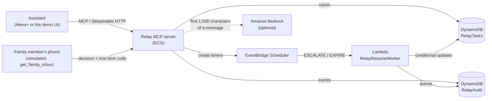
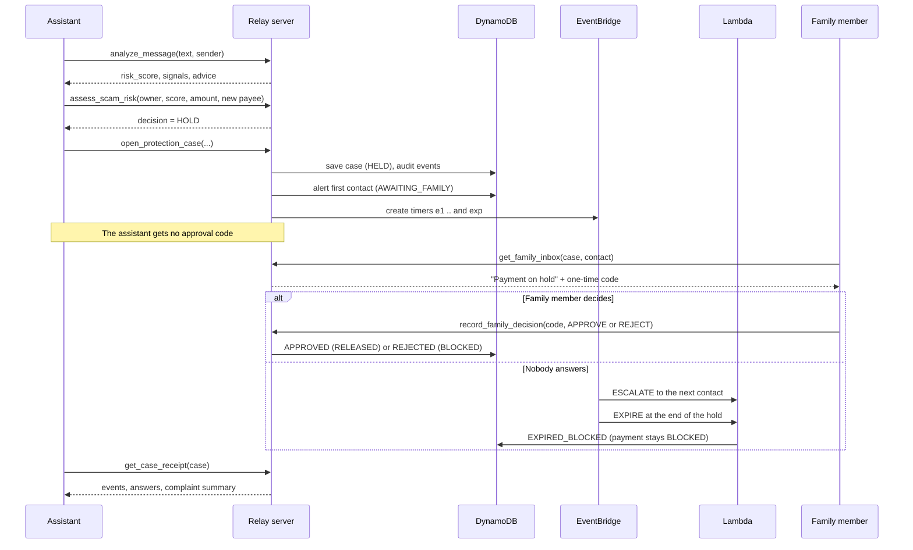
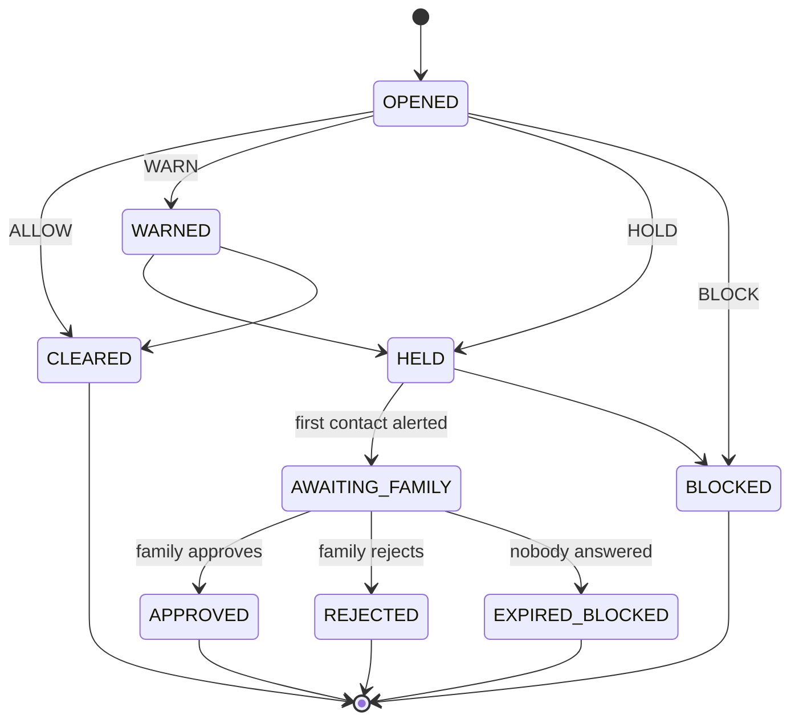

# Relay Shield — Design

Relay Shield protects a person from scam payments by putting a human in the
loop. When an assistant sees a suspicious message and a payment is about to
move, Shield holds the payment, alerts a trusted family member, and releases it
only if that person approves with a one-time code. **If nobody answers, the
payment stays blocked.**

> **Reasoning may be probabilistic. Authority should not be.**
> Rules and an optional model *recommend*. A state machine and a human *decide*.

This document explains how Shield works. Tool-by-tool details are in
[relay-shield-api.md](./relay-shield-api.md), threats in
[relay-shield-security.md](./relay-shield-security.md), running and deploying in
[relay-shield-operations.md](./relay-shield-operations.md), and tests in
[relay-shield-testing.md](./relay-shield-testing.md).

- [1. How it fits into Relay](#1-how-it-fits-into-relay)
- [2. Architecture](#2-architecture)
- [3. The flow, step by step](#3-the-flow-step-by-step)
- [4. Scoring a message](#4-scoring-a-message)
- [5. The payment decision](#5-the-payment-decision)
- [6. The case state machine](#6-the-case-state-machine)
- [7. Family approval codes](#7-family-approval-codes)
- [8. Escalation and expiry timers](#8-escalation-and-expiry-timers)
- [9. The case record](#9-the-case-record)
- [10. The audit trail and receipt](#10-the-audit-trail-and-receipt)
- [11. Design decisions](#11-design-decisions)
- [12. Real and simulated](#12-real-and-simulated)

## 1. How it fits into Relay

Relay is a durable execution layer: it keeps a task's constraints, approvals and
history outside the conversation, so a task survives failures and waiting.
Shield reuses the same parts for a different job.

| Relay part | Used by Shield for |
|---|---|
| MCP server on ECS | The 9 Shield tools, 1 resource and 1 prompt (26 tools in total with the original 17) |
| DynamoDB `RelayTasks` | The case record (`kind = "scam_case"`) |
| DynamoDB `RelayAudit` | The evidence trail for each case |
| EventBridge Scheduler | One timer per escalation and one expiry timer per case |
| Lambda `RelayResumeWorker` | Moves a case to the next contact, or blocks it when time runs out |
| Deterministic policy | The payment decision and the legal state transitions |
| Amazon Bedrock | An optional second opinion on a message. It can only raise the score |

The original 17 Relay tools are unchanged. A test fingerprints their source.

## 2. Architecture

Two writers change a case: the server (opening, alerting, deciding) and the
Lambda (escalating, expiring). Both use DynamoDB **conditional updates**, so a
late or repeated event cannot overwrite a newer state.

## 3. The flow, step by step

1. **Analyze.** `analyze_message` scores the text. `check_number` can look up a
   sender.
2. **Assess.** `assess_scam_risk` turns a score, an amount and a payee into
   ALLOW, WARN, HOLD or BLOCK. It changes nothing.
3. **Open a case.** `open_protection_case` records the decision. For a HOLD it
   also alerts the first trusted contact and creates the timers, so a held
   payment is never left without an alert.
4. **Family decides.** The family member's device reads the code from
   `get_family_inbox` and calls `record_family_decision`. The first valid
   decision wins.
5. **Or time runs out.** The timers escalate to the next contact and finally
   block the payment.
6. **Receipt.** `get_case_receipt` explains what happened in plain language.

## 4. Scoring a message

`relay/scam/scoring.py` looks for known scam patterns. Each signal that is
found adds its weight. The total is capped at 100.

| Signal | Weight | What it looks for |
|---|---|---|
| `otp_request` | 40 | Asking you to share an OTP, PIN, CVV or password. "Do not share your OTP" does **not** count |
| `impersonation` | 25 (12 for a bare brand name) | "This is SBI", "calling from the police", a bank or government name with a title |
| `threat` | 25 | Arrest, blocking, legal action |
| `prize_lottery` | 25 | Prizes and lottery wins |
| `remote_access` | 35 | AnyDesk, TeamViewer, screen sharing, installing an app or APK |
| `payment_demand` | 20 | Transfer, fees, gift cards, UPI collect requests, QR codes |
| `suspicious_link` | 20 | `http://` links and link shorteners |
| `kyc_update` | 20 | "Update your KYC" |
| `urgency` | 15 | "Immediately", "within 2 hours", "last warning" |
| `known_scam_sender` | 40 | The sender is in the (synthetic) scam list |
| `suspicious_sender` | 15 | The sender is in the (synthetic) suspicious list |

**Combination rule.** An OTP request together with impersonation scores **at
least 85**. This is the classic bank-scam message.

| Score | Level | Recommended action |
|---|---|---|
| 0–24 | LOW | NONE |
| 25–49 | MEDIUM | NONE below 40, WARN from 40 |
| 50–74 | HIGH | WARN, and HOLD_PAYMENTS from 70 |
| 75–100 | CRITICAL | HOLD_PAYMENTS |

The levels (25 / 50 / 75) and the actions (40 / 70) are two separate scales.

**Evidence is masked.** Each signal shows a short snippet, at most 40
characters, with digit runs hidden. The text is never stored.

**The model's second opinion.** If `OPENAI_API_KEY` is set, the first 1,500
characters go to a Bedrock model with a prompt that treats the message as
untrusted data. The model's answer can only **add** a `model_<type>` signal
(weight = confidence × 40). It can never lower a score. It has an 8-second
timeout, and any failure falls back to the rules alone. The reply says which
path was used: `"source": "rules"` or `"rules+model"`.

## 5. The payment decision

`relay/scam/policy.py`, `assess_payment`. Rules are checked in this order, and
the first match wins.

| # | Condition | Decision |
|---|---|---|
| 1 | The risk score is missing or outside 0–100, the amount is invalid, or the profile has no valid limit | **BLOCK** (default-deny) |
| 2 | Risk ≥ 70 and a payment above zero | **HOLD** |
| 3 | The amount is above the payment limit **and** the payee is new | **HOLD** |
| 4 | Risk ≥ 40 | **WARN** |
| 5 | Otherwise | **ALLOW** |

The demo profile (`user_savita`) has a payment limit of Rs 10,000, a 30-minute
cooling-off period, and two trusted contacts: Rohan first, then Anita.

Each action also has a risk tier, and unknown actions are blocked:

| Action | Tier | Needs |
|---|---|---|
| Analyze a message, check a number | READ_ONLY | Nothing |
| Open a case, alert a contact | REVERSIBLE | Nothing |
| Record a family decision | COMMITMENT | A valid family approval code |
| Release a payment | IRREVERSIBLE | Family approval |
| Anything else | IRREVERSIBLE | Blocked |

## 6. The case state machine

- There are 9 statuses, and a test checks every one of the 81 pairs.
- `CLEARED`, `BLOCKED`, `APPROVED`, `REJECTED` and `EXPIRED_BLOCKED` are final:
  they never change again.
- **No path leads from "nobody answered" to a released payment.** The only
  timeout outcome is `EXPIRED_BLOCKED`, and the payment status stays `BLOCKED`.
- Escalation to the next contact is an *event* inside `AWAITING_FAMILY`, not a
  separate status.

| Final status | Payment status |
|---|---|
| `CLEARED` | `NONE` |
| `WARNED` | `NONE` |
| `BLOCKED` | `BLOCKED` |
| `APPROVED` | `RELEASED` |
| `REJECTED` | `BLOCKED` |
| `EXPIRED_BLOCKED` | `BLOCKED` |

## 7. Family approval codes

`relay/scam/tokens.py`.

- **Derived, not stored.** The code is the first 8 characters (base32,
  upper-case) of `HMAC-SHA256(RELAY_SHIELD_SECRET, case_id : contact_id :
  issued_at)`. The database holds only `issued_at`, `expires_at`, `used` and
  `attempts`. Reading the database does not reveal a code.
- **40 bits.** Eight base32 characters are 40 bits of entropy.
- **Forgiving input.** Spaces, dashes and lowercase are accepted. Anything that
  is not a string returns "invalid" rather than raising an error.
- **Constant-time comparison** (`hmac.compare_digest`).
- **Three wrong codes lock that contact.** Locked contacts do not unlock.
- **One use.** A conditional update sets the decision and marks the entry used
  in one write, so a replayed code or a second decision fails.
- **Expires with the hold.** The code stops working when the hold ends.
- **One place shows it.** Only `get_family_inbox` returns a code. The alert
  reply, the case, the receipt and the logs never contain one.
- **No default secret.** If `RELAY_SHIELD_SECRET` is missing, alerting and
  deciding fail closed.

## 8. Escalation and expiry timers

When the first contact is alerted, the server creates one-time EventBridge
schedules named `relay-resume-<case id>-<suffix>`:

| Timer | Suffix | Fires at | Lambda step |
|---|---|---|---|
| Escalate to contact *k* | `e{k}` | `hold_started_at + k × step` | `ESCALATE` with `to_index = k` |
| Expire | `exp` | `hold_expires_at` | `EXPIRE` |

`step` is the cooling-off time divided by the number of contacts, and never less
than 1 minute. With the demo profile and a 2-minute hold, Rohan is alerted at
once, Anita is alerted at about 1 minute, and the case expires at about 2
minutes. With the default 30-minute hold, Anita is alerted at 15 minutes.

The Lambda (`lambda/resume_worker/handler.py`):

- changes a case only with a conditional update on the status and the contact
  index, so a stale, duplicated or out-of-order event is skipped and logged
  (`ESCALATE_SKIPPED`, `EXPIRE_SKIPPED`);
- can **escalate** or **expire**. It has no code path that approves or releases;
- imports nothing from the `relay` package (a test enforces this) and prints only
  the case id and the step.

If a timer cannot be created, `timers_failed` is reported and the payment simply
stays held until someone decides. A failed timer never releases money.

## 9. The case record

One item in `RelayTasks`, keyed by `task_id`:

| Field | Meaning |
|---|---|
| `task_id`, `kind` | `case-<uuid>`, always `scam_case` |
| `owner_id` | The protected person. Every case tool checks it |
| `status`, `payment_status` | Case status (section 6) and what happens to the money |
| `risk_score`, `risk_level`, `signals` | The score and the signal **names** only |
| `decision`, `reasons` | The policy result and its reasons |
| `amount`, `payee_label`, `payee_is_new` | The payment. The payee is stored masked (`Payee 98******10`) |
| `contacts` | Contact ids, names and order. No phone numbers |
| `current_contact_index` | `-1` until the first alert, then the contact being asked |
| `approvals` | Per contact: `issued_at`, `expires_at`, `used`, `attempts`. Never a code |
| `cooling_off_minutes` | 2 to 60. The default is the profile's 30 |
| `hold_started_at`, `hold_expires_at` | The hold window |
| `alert_call_count` | Calls to the alert tool, at most 5 |
| `created_at`, `approved` | Bookkeeping |

## 10. The audit trail and receipt

Every step writes an event to `RelayAudit` (partition key `task_id`):
`CASE_OPENED`, `POLICY_EVALUATED`, `PAYMENT_HELD`, `CONTACT_ALERTED`,
`ESCALATED`, `BAD_APPROVAL_CODE`, `FAMILY_APPROVED`, `FAMILY_REJECTED`,
`PAYMENT_RELEASED`, `PAYMENT_BLOCKED`, `HOLD_EXPIRED`, and the `_SKIPPED` events.

`get_case_receipt` turns these into a record a person can read and attach to a
bank or police complaint. It answers four questions: **why it was flagged, what
was held, who decided and how, and the final outcome**. It removes any key named
`approval_code`, `token` or `secret` at every depth.

## 11. Design decisions

| Decision | Reason |
|---|---|
| Default-deny everywhere | A wrong "no" costs a pause. A wrong "yes" costs someone their savings |
| Silence blocks | Scammers rely on pressure and delay. The system must not give in to either |
| The model can only raise a score | A tricked or failing model can make Shield *more* careful, never less |
| Derived codes | No approval secret sits in the database |
| Wrong owner looks like a missing case | A caller cannot probe which cases exist |
| Conditional updates on every write | The server and the Lambda both write cases |
| Timers do not rewrite the case record | Creating a timer must not overwrite a newer state |
| Store signal names, not message text | The victim's message is private |
| A standalone Lambda handler | A small package that cannot import application code and fails in fewer ways |

## 12. Real and simulated

| Real | Simulated |
|---|---|
| MCP server, tools, resource and prompt | The family member's phone: `get_family_inbox` stands in for SMS or push |
| Scoring, policy and the state machine | Identity: `owner_id` is a tool argument, not a verified login |
| DynamoDB cases and audit trail | The scam number list (synthetic numbers `900000000x`) |
| EventBridge timers and the Lambda | The trusted contacts (fixed demo data) |
| Approval codes, locking and expiry | Payment rails: no money moves, "released" is a recorded state |
| The Bedrock second opinion (when a key is set) | Alexa+ itself (the demo UI plays its part) |

What production would change is in
[relay-shield-security.md](./relay-shield-security.md#6-the-simulation-boundary)
and [production-auth-architecture.md](./production-auth-architecture.md).
