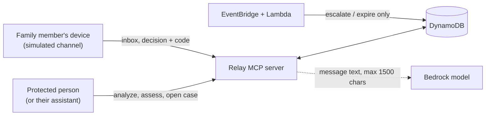

# Relay Shield — Security and Privacy

This document explains what Relay Shield protects, how, and where the
prototype deliberately stops short. It is written to be checked: each
protection names the test that guards it.

Production identity and delivery are covered in
[production-auth-architecture.md](./production-auth-architecture.md).

## 1. What is being protected

| Asset | Why it matters |
|---|---|
| The money in a held payment | The whole point: it must not leave without a human decision |
| The family approval code | Whoever has it can approve a payment |
| `RELAY_SHIELD_SECRET` | The key the codes are derived from |
| Case data and the audit trail | Reveals who was targeted, how much, and who was alerted |
| Message text, numbers and OTPs | The victim's private information |

## 2. Core principles

1. **Default-deny.** Invalid input, an unknown action, a broken profile or an
   unknown state is refused. Nothing is allowed by omission.
2. **Silence never releases money.** There is no path from "nobody answered" to
   "payment released". The only timeout outcome is `EXPIRED_BLOCKED`.
3. **Authority is separate from reasoning.** An assistant can analyze and
   explain. Only a human holding a one-time code can release a payment.
4. **Least data.** Store masked values and signal names, never raw OTPs, full
   phone numbers or full message text.
5. **Every change is conditional.** The server and the Lambda can both write a
   case, so every status change is a DynamoDB conditional update.

## 3. Trust boundaries

- The assistant side can open and read cases but should never hold a code.
- The family device is the only place a code should appear.
- The timer path can escalate and block. It cannot approve or release.
- The model sees at most the first 1,500 characters of the message and nothing
  else.

## 4. Threats and protections

| Threat | Protection | Guarded by |
|---|---|---|
| An assistant approves its own payment hold | The decision tool needs a valid one-time code; tool descriptions and the prompt forbid it; the optional Bedrock agent is never given the family tools | `test_scam_server_surface.py` (`test_agent_tools_do_not_expose_family_tools`), `test_scam_security.py` (`test_family_code_only_exists_in_inbox_surface`) |
| Guessing the approval code | 8 base32 characters (40 bits), 3 wrong attempts lock that contact, the code expires when the hold ends | `test_scam_security.py` (`test_wrong_code_limit_is_three`), `test_scam_family.py` (`test_three_wrong_codes_lock_the_contact`, `test_expired_entry_cannot_decide`) |
| Replaying a used code | A conditional update marks the entry used while setting the decision | `test_scam_family.py` (`test_replaying_a_used_code_fails`) |
| Two decisions at the same moment | The decision update requires status `AWAITING_FAMILY` and an unused entry; the loser gets "Case already decided" | `test_scam_family.py` (`test_decision_racing_a_lockout_is_refused_by_the_conditional_update`) and the integration test `test_scam_case.py` (second decision refused) |
| Reading or acting on another person's case | Every case tool checks `owner_id`; a wrong owner gets the **same** reply as a missing case, so existence cannot be probed | `test_scam_security.py` (`test_wrong_owner_matches_missing_case`, `test_receipt_wrong_owner_does_not_read_audit`) |
| Timer delivered twice, late, or out of order | Lambda updates are conditional on status and contact index; stale events are skipped and logged | `test_lambda_scam_edge.py` |
| Silence releasing money | State machine has no such path; the Lambda only blocks, and its source never mentions a released payment | `test_scam_policy_edge.py`, `test_lambda_scam_edge.py` |
| Secrets or private data in logs, audit events or receipts | Evidence is masked; the Lambda prints only task id and step; the receipt removes keys named `approval_code`, `token` or `secret` at every depth | `test_scam_receipt_edge.py`, `test_lambda_scam_edge.py` |
| Prompt injection through the message text | The model is told the message is untrusted data, can only raise the score, receives at most 1,500 characters, and any failure falls back to the rules | `test_scam_classifier_edge.py` |
| Oversized or abusive input | Message length 2,000, amount 0–10,000,000, `owner_id` pattern, 5 alert calls per case | `test_scam_security.py` |
| A missing secret silently weakening codes | There is no default secret; alerting and deciding fail closed | `test_scam_security.py` (`test_missing_shield_secret_fails_closed`) |
| Two writers overwriting each other | Status and approval changes use conditional updates, and timers are created without rewriting the case record | `test_scam_security.py` (`test_security_sensitive_mutations_use_conditional_updates`), `test_scheduler_resume_edge.py` |
| DNS rebinding or a spoofed Host header | The MCP endpoint validates Host and Origin; unlisted hosts get HTTP 421 | `test_scam_server_surface.py` and the manual check in [relay-shield-operations.md](./relay-shield-operations.md) |
| The Lambda pulling in application code | The handler is standalone: a static test forbids importing `relay` | `test_lambda_scam_edge.py` |
| Someone tampering with the original 17 tools | A test fingerprints their source | `test_scam_server_surface.py` (`test_original_tools_are_unchanged`) |

## 5. What is stored and what is not

| Stored | Not stored |
|---|---|
| Masked payee label (`Payee 98******10`) | The full payee number or text |
| Signal **names** (`otp_request`) | The message text |
| Amount, risk score, decision, reasons | OTPs, PINs or card numbers |
| Approval entries: `issued_at`, `expires_at`, `used`, `attempts` | The approval code itself |
| Contact ids and names | Contact phone numbers |
| Audit events with masked details | Secrets, keys or tokens |

The approval code is recomputed on demand from the secret, the case id, the
contact id and the issue time. Reading the database does not reveal a code
without `RELAY_SHIELD_SECRET`.

## 6. The simulation boundary

These parts are simulated in the prototype, and the limits that follow from
that are real:

| Simulated | What it means today | Production fix |
|---|---|---|
| **Family delivery.** `get_family_inbox` stands in for SMS or push | Anyone who can call the tool and knows a case id and a contact id can read the code. The protection against an assistant approving its own hold is the one-time code plus procedure (tool descriptions, the prompt, and not giving the family tools to the optional Bedrock agent) | Send the request by SMS or push to a verified phone. The code never passes through MCP |
| **Identity.** `owner_id` is a tool argument | A caller could name any owner id | Derive the owner from an authenticated identity provider (OAuth or OIDC), not from a model-supplied argument |
| **Trusted contacts** are fixed demo data | No onboarding or verification of contacts | Verified contact enrollment with consent |
| **Scam numbers** are a synthetic list | Reputation is not real | A reviewed, regularly updated feed |
| **Payment rails.** No money moves | "Released" is a recorded state | A bank or UPI integration that honors the hold |

The design is built so these can be swapped without changing the case state
machine or the Lambda.

## 7. Secrets and configuration

- `RELAY_SHIELD_SECRET` and `OPENAI_API_KEY` must never be committed.
  `.env.example` lists names only. In AWS they should be injected as ECS task
  secrets.
- Rotating `RELAY_SHIELD_SECRET` invalidates codes for cases that are still
  open. Those cases expire on their own.
- `RELAY_PUBLIC_HOST` must list the deployed hostname, or the server rejects
  real requests with HTTP 421.

## 8. Residual risks

1. The simulation boundary above. Do not describe the prototype as having
   authenticated family approval.
2. The `open_protection_case` reply is a pre-alert snapshot; read
   `get_protection_case` for the truth.
3. If the expiry timer cannot be created, the payment stays held (never
   released) until a decision. The alert reply reports `timers_failed`.
4. A 40-bit code with a 3-attempt lock per contact is strong against guessing
   inside one hold window, but it is a one-time code, not an authenticated
   identity.
5. The scoring rules are heuristics. They can miss a scam or flag a harmless
   message; the policy is built so a miss costs a pause, not an irreversible
   action.
6. AWS account identifiers appear in `infra/iam/*.json`. They are not
   credentials, but decide whether you want them in a public repository.

## 9. Checklist before a public demo

- [ ] No secrets or keys in the repository (`git grep -nE "(OPENAI_API_KEY|RELAY_SHIELD_SECRET) *= *[A-Za-z0-9]"` finds nothing)
- [ ] `RELAY_SHIELD_SECRET` and `OPENAI_API_KEY` are ECS secrets, not plain environment text in files
- [ ] `RELAY_PUBLIC_HOST` is set, and `/mcp` (not only `/health`) answers
- [ ] The logs for a demo run contain no message text and no approval code
- [ ] The documents say "simulated" wherever the family phone, identity or numbers are described
